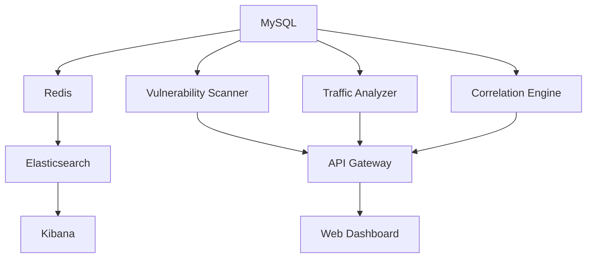

# Unified Security Platform - Container Architecture Overview

**Project:** IoT Security & Network Monitoring Platform  
**Version:** 1.0.0  
**Date:** November 1, 2025  
**Architecture:** Microservices with Docker Containerization

## 📋 Executive Summary

The Unified Security Platform is a comprehensive IoT security solution that combines vulnerability assessment, network traffic analysis, and intelligent correlation into a single integrated platform. The system is built using a microservices architecture with 11 containerized services working together to provide complete security visibility and automated threat detection.

---

## 🏗️ Architecture Overview

```
┌─────────────────────────────────────────────────────────────────────┐
│                        UNIFIED SECURITY PLATFORM                    │
├─────────────────────────────────────────────────────────────────────┤
│  Web Dashboard (nginx:80) ←→ API Gateway (flask:8000)              │
│                                    ↓                                │
│  ┌─────────────────┬─────────────────┬─────────────────────────┐    │
│  │ Vulnerability   │ Traffic         │ Correlation             │    │
│  │ Scanner Service │ Analyzer Service│ Engine Service          │    │
│  │ (flask:5001)    │ (flask:5002)    │ (flask:5003)            │    │
│  └─────────────────┴─────────────────┴─────────────────────────┘    │
│                                    ↓                                │
│  ┌─────────────────────────────────────────────────────────────┐    │
│  │            Shared Infrastructure Layer                      │    │
│  │  MySQL DB    Redis Cache    Elasticsearch    Kibana        │    │
│  │  (:3306)     (:6379)       (:9200)          (:5601)       │    │
│  └─────────────────────────────────────────────────────────────┘    │
└─────────────────────────────────────────────────────────────────────┘
```

---

## 🐳 Container Detailed Specifications

### 1. **unified-db** - MySQL Database Server
- **Image:** `mysql:8.0`
- **Purpose:** Centralized data storage for all security information
- **Port:** `3306:3306`
- **Network:** `security-net`
- **Resources:** 
  - Memory: ~512MB
  - Storage: Persistent volume `mysql_data`

**Database Schema:**
```sql
├── devices (IoT device inventory)
├── device_ports (Open ports and services)
├── vulnerabilities (CVE database)
├── device_vulnerabilities (Device-to-vulnerability mapping)
├── scan_results (Scan execution history)
├── network_events (Traffic analysis events)
├── security_alerts (Suricata alerts)
├── traffic_flows (Network flow data)
├── security_incidents (Correlated incidents)
├── correlation_rules (Automation rules)
├── threat_intelligence (IOC database)
├── users (User management)
├── audit_logs (System audit trail)
└── system_config (Platform configuration)
```

**Environment Variables:**
- `MYSQL_ROOT_PASSWORD`: Root database password
- `MYSQL_DATABASE`: unified_security
- `MYSQL_USER`: security_user
- `MYSQL_PASSWORD`: Database user password

---

### 2. **unified_security_redis** - Redis Cache & Message Broker
- **Image:** `redis:6-alpine`
- **Purpose:** Caching, session storage, and inter-service messaging
- **Port:** `6379:6379`
- **Network:** `security-net`
- **Resources:** 
  - Memory: ~256MB
  - Storage: In-memory with persistence

**Redis Databases:**
- **DB 0:** Celery broker queue
- **DB 1:** Celery result backend
- **DB 2:** API caching layer
- **DB 3:** Session storage

**Message Channels:**
- `scan_updates`: Vulnerability scan progress
- `security_events`: Real-time security alerts
- `traffic_events`: Network traffic notifications
- `alert_updates`: Security alert status changes

---

### 3. **unified_api_gateway** - Central API Gateway
- **Image:** Custom Flask application
- **Source:** `./api-gateway/`
- **Purpose:** Single entry point, authentication, and request routing
- **Port:** `8000:8000`
- **Network:** `security-net`

**Key Features:**
- JWT-based authentication system
- Rate limiting (100 requests/hour per IP)
- Request routing to microservices
- Health monitoring and aggregation
- Real-time event streaming (Server-Sent Events)
- CORS handling for web dashboard

**API Endpoints:**
```
Authentication:
  POST /api/auth/login

Vulnerability Management:
  GET|POST /api/scans
  GET /api/scans/{scan_id}
  GET /api/devices
  GET /api/vulnerabilities

Traffic Analysis:
  GET /api/alerts
  GET /api/traffic/flows
  GET /api/traffic/stream (SSE)

Correlation & Intelligence:
  GET|POST /api/incidents
  GET|POST /api/correlation/rules
  GET /api/threat-intelligence

Dashboard:
  GET /api/dashboard/overview
  GET /api/events/subscribe (SSE)

System:
  GET /health
```

**Dependencies:**
- Flask 2.3.3
- Flask-CORS 6.0.1
- Redis 5.0.1
- PyJWT 2.8.0
- Requests 2.31.0

---

### 4. **vulnerability_scanner_service** - Network Vulnerability Scanner
- **Image:** Custom Flask + nmap application
- **Source:** `./services/vulnerability-scanner/`
- **Purpose:** Network discovery, port scanning, and vulnerability assessment
- **Port:** `5001:5001`
- **Network:** `security-net`
- **Capabilities:** `NET_RAW`, `NET_ADMIN` (for nmap)

**Core Functionality:**
- Network host discovery (`nmap -sn`)
- Detailed port scanning (`nmap -sV -O`)
- Operating system fingerprinting
- Service version detection
- CVE vulnerability matching
- Automated risk assessment

**Scanning Process:**
```
1. Network Discovery → Find active hosts
2. Port Scanning → Identify open services
3. OS Fingerprinting → Determine device type
4. Service Detection → Extract version info
5. Vulnerability Matching → Query CVE database
6. Risk Assessment → Calculate threat level
7. Database Storage → Save results
8. Event Publishing → Notify correlation engine
```

**API Endpoints:**
- `GET /health` - Service health check
- `GET|POST /scans` - Manage scan operations
- `GET /scans/{id}` - Get scan status/results
- `GET /devices` - List discovered devices
- `GET /vulnerabilities` - List vulnerabilities
- `GET /dashboard/devices` - Device metrics
- `GET /dashboard/vulnerabilities` - Vulnerability metrics

**Dependencies:**
- Flask 2.3.3
- python-nmap 0.7.1
- mysql-connector-python 8.2.0
- Celery 5.3.1 (async processing)

---

### 5. **vuln_celery_worker** - Vulnerability Scan Worker
- **Image:** Same as vulnerability scanner
- **Purpose:** Asynchronous execution of network scans
- **Network:** `security-net`
- **Capabilities:** `NET_RAW`, `NET_ADMIN`

**Worker Tasks:**
- `scan_network_task`: Execute network discovery and scanning
- `update_vulnerability_db`: Sync CVE database
- `calculate_risk_scores`: Update device risk levels
- `generate_scan_reports`: Create detailed reports

**Celery Configuration:**
- Broker: Redis DB 0
- Backend: Redis DB 1
- Serializer: JSON
- Queue: `scan_queue`

---

### 6. **traffic_analyzer_service** - Network Traffic Analysis
- **Image:** Custom Flask + Suricata application
- **Source:** `./services/traffic-analyzer/`
- **Purpose:** Real-time network monitoring and intrusion detection
- **Ports:** 
  - `5002:5002` (Flask API)
  - `50051:50051` (gRPC server)
- **Networks:** 
  - `security-net` (172.20.0.10)
  - `monitor-net` (192.168.100.10)
- **Capabilities:** `NET_ADMIN`, Privileged mode

**Components:**
1. **Suricata IDS/IPS Engine**
   - Real-time packet inspection
   - Signature-based detection
   - Protocol analysis (HTTP, DNS, TLS, SSH)
   - Custom rule management

2. **gRPC Event Processor**
   - Receives Suricata EVE logs
   - Processes JSON events
   - Forwards to correlation engine

3. **Flask API Service**
   - Security alert management
   - Traffic flow analysis
   - Real-time event streaming

**Suricata Configuration:**
```yaml
af-packet:
  - interface: monitor-net
    cluster-id: 99
    cluster-type: cluster_flow
    
outputs:
  - eve-log:
      enabled: yes
      filename: eve.json
      types:
        - alert
        - flow
        - http
        - dns
        - tls
```

**API Endpoints:**
- `GET /health` - Service health
- `GET /alerts` - Security alerts
- `GET /traffic/flows` - Network flows
- `GET /events/stream` - Real-time events
- `POST /suricata/rules` - Rule management

---

### 7. **unified_nat_router** - Network Address Translation Router
- **Image:** Custom routing container
- **Source:** `./services/traffic-analyzer/nat-router/`
- **Purpose:** Network traffic management and routing
- **Port:** `5050:5050`
- **Networks:**
  - `security-net` (172.20.0.7)
  - `monitor-net` (192.168.100.254 - Gateway)
- **Capabilities:** `NET_ADMIN`, Privileged mode

**Functions:**
- NAT routing between networks
- Traffic quarantine management
- Suricata rule deployment
- Network policy enforcement

---

### 8. **correlation_engine_service** - Security Event Correlation
- **Image:** Custom Flask application
- **Source:** `./services/correlation-engine/`
- **Purpose:** Intelligent correlation of security events and incident management
- **Port:** `5003:5003`
- **Network:** `security-net`

**Correlation Rules Engine:**

1. **Vulnerability-Traffic Correlation**
   - Matches devices with critical vulnerabilities to network alerts
   - Creates high-priority incidents for vulnerable devices showing suspicious activity

2. **Threat Intelligence Correlation**
   - Monitors communication with known malicious IPs
   - Cross-references IOCs with network flows
   - Creates critical incidents for confirmed threats

3. **Anomaly Detection**
   - Behavioral analysis of network patterns
   - Detection of port scanning and brute force attacks
   - Identification of unusual traffic from new devices

4. **Behavioral Analysis**
   - Machine learning-based pattern recognition
   - Baseline establishment for normal behavior
   - Deviation detection and alerting

**Processing Workflow:**
```
1. Event Collection → Gather from all sources
2. Rule Processing → Apply correlation rules
3. Pattern Analysis → Identify anomalies
4. Incident Creation → Generate security incidents
5. Risk Scoring → Calculate threat levels
6. Alert Generation → Notify operators
7. Response Tracking → Monitor resolution
```

**API Endpoints:**
- `GET /health` - Service health
- `GET|POST /incidents` - Security incident management
- `GET|POST /rules` - Correlation rule management
- `GET|POST /threat-intelligence` - IOC management
- `GET /dashboard/incidents` - Incident metrics

---

### 9. **unified_web_dashboard** - Web User Interface
- **Image:** `nginx:alpine`
- **Source:** `./web-dashboard/`
- **Purpose:** Unified web interface for security operations
- **Port:** `8080:80`
- **Network:** `security-net`

**Frontend Technology Stack:**
- **Framework:** Pure HTML5/CSS3/JavaScript
- **UI Library:** Bootstrap 5.1.3
- **Charts:** Chart.js
- **Icons:** Font Awesome 6.0.0
- **Real-time:** Server-Sent Events (SSE)

**Dashboard Sections:**

1. **Overview Dashboard**
   - Real-time security metrics
   - Vulnerability distribution charts
   - Security events timeline
   - Recent incidents summary
   - Live event stream

2. **Device Management**
   - Network device inventory
   - Device risk assessment
   - Vulnerability status
   - Port and service details

3. **Vulnerability Management**
   - CVE database browser
   - Severity-based filtering
   - Affected device mapping
   - Remediation tracking

4. **Traffic Analysis**
   - Network flow visualization
   - Security alert management
   - Protocol statistics
   - Anomaly indicators

5. **Incident Response**
   - Security incident workflow
   - Investigation timeline
   - Response actions
   - Status tracking

6. **Scan Management**
   - Network scan configuration
   - Scan history and results
   - Scheduled scanning
   - Progress monitoring

**Nginx Configuration:**
- Reverse proxy to API Gateway
- Static asset caching
- WebSocket support for SSE
- Security headers implementation

---

### 10. **unified_elasticsearch** - Search and Analytics Engine
- **Image:** `docker.elastic.co/elasticsearch/elasticsearch:8.11.0`
- **Purpose:** Log aggregation, search, and analytics
- **Port:** `9200:9200`
- **Network:** `security-net`
- **Storage:** Persistent volume `elasticsearch_data`

**Data Sources:**
- Suricata EVE logs
- Application logs from all services
- Audit trail from user actions
- System performance metrics

**Index Templates:**
```
suricata-logs-*     → Network security events
application-logs-*  → Service application logs
audit-logs-*        → User and system audit trail
metrics-*           → Performance and health metrics
```

**Configuration:**
- Single-node cluster
- Security disabled (internal network)
- JVM heap: 512MB
- Discovery type: single-node

---

### 11. **unified_kibana** - Data Visualization and Analytics
- **Image:** `docker.elastic.co/kibana/kibana:8.11.0`
- **Purpose:** Log analysis and security analytics dashboards
- **Port:** `5601:5601`
- **Network:** `security-net`

**Pre-configured Dashboards:**
1. **Security Operations Center (SOC)**
   - Real-time security event monitoring
   - Threat detection timeline
   - Geographic threat distribution
   - Attack pattern analysis

2. **Network Traffic Analysis**
   - Protocol distribution
   - Top talkers and listeners
   - Bandwidth utilization
   - Connection patterns

3. **Vulnerability Management**
   - Vulnerability trends over time
   - Risk score distribution
   - Remediation progress
   - Compliance reporting

4. **System Health Monitoring**
   - Service availability
   - Performance metrics
   - Error rate tracking
   - Resource utilization

---

## 🔗 Container Dependencies and Communication

### Network Communication Matrix

| Container | Communicates With | Protocol | Purpose |
|-----------|-------------------|----------|---------|
| API Gateway | All services | HTTP/HTTPS | Request routing |
| Web Dashboard | API Gateway | HTTP + SSE | User interface |
| Vulnerability Scanner | MySQL, Redis | TCP | Data persistence |
| Traffic Analyzer | MySQL, Redis, gRPC Server | TCP/gRPC | Event processing |
| Correlation Engine | MySQL, Redis, All services | HTTP/TCP | Event correlation |
| gRPC Server | Traffic Analyzer, Laravel | gRPC/HTTP | Event forwarding |
| All services | Redis | TCP | Caching & messaging |
| All services | MySQL | TCP | Data storage |
| Kibana | Elasticsearch | HTTP | Visualization |

### Startup Dependencies



---

## 📊 Resource Requirements

### Minimum System Requirements
- **CPU:** 4 cores (2.0 GHz)
- **Memory:** 8 GB RAM
- **Storage:** 50 GB SSD
- **Network:** 1 Gbps Ethernet

### Production Recommendations
- **CPU:** 8 cores (2.5 GHz)
- **Memory:** 16 GB RAM
- **Storage:** 200 GB NVMe SSD
- **Network:** 10 Gbps Ethernet

### Container Resource Allocation

| Container | CPU Limit | Memory Limit | Storage |
|-----------|-----------|--------------|---------|
| MySQL | 1.0 | 2 GB | 20 GB |
| Redis | 0.5 | 512 MB | 1 GB |
| API Gateway | 1.0 | 1 GB | - |
| Vulnerability Scanner | 2.0 | 2 GB | - |
| Traffic Analyzer | 2.0 | 2 GB | 10 GB |
| Correlation Engine | 1.0 | 1 GB | - |
| Web Dashboard | 0.5 | 256 MB | - |
| Elasticsearch | 2.0 | 2 GB | 20 GB |
| Kibana | 1.0 | 1 GB | - |

---

## 🔧 Configuration Management

### Environment Variables Overview

| Variable | Used By | Purpose |
|----------|---------|---------|
| `DB_HOST`, `DB_USER`, `DB_PASS` | All services | Database connectivity |
| `REDIS_HOST`, `REDIS_PORT` | All services | Cache connectivity |
| `JWT_SECRET` | API Gateway | Authentication |
| `CELERY_BROKER_URL` | Scanner, Workers | Task queue |
| `FLASK_DEBUG` | All Flask apps | Debug mode |
| `FALLBACK_SUBNET` | Scanner | Default scan range |

### Volume Mounts

| Volume | Mount Point | Purpose |
|--------|-------------|---------|
| `mysql_data` | `/var/lib/mysql` | Database persistence |
| `suricata_logs` | `/var/log/suricata` | Log storage |
| `dashboard_storage` | `/var/www/html/storage` | Web assets |
| `elasticsearch_data` | `/usr/share/elasticsearch/data` | Search index |

---

## 🚀 Deployment Process

### 1. Pre-deployment Checklist
- [ ] Docker and Docker Compose installed
- [ ] Network requirements met
- [ ] Firewall rules configured
- [ ] SSL certificates available (production)

### 2. Environment Setup
```bash
# Clone repository
git clone <repository-url>
cd UnifiedSecurityPlatform

# Configure environment
cp .env.example .env
# Edit .env with your settings

# Create necessary directories
mkdir -p {logs,data/mysql,data/elasticsearch,data/suricata-logs}
```

### 3. Deployment Commands
```bash
# Build and start all services
docker-compose up -d

# Verify deployment
docker-compose ps
curl http://localhost:8000/health

# View logs
docker-compose logs -f
```

### 4. Post-deployment Tasks
- [ ] Change default passwords
- [ ] Configure network scanning ranges
- [ ] Set up threat intelligence feeds
- [ ] Configure correlation rules
- [ ] Set up monitoring and alerting

---

## 🔍 Monitoring and Maintenance

### Health Monitoring

Each container provides health check endpoints:
- **API Gateway:** `http://localhost:8000/health`
- **Vulnerability Scanner:** `http://localhost:5001/health`
- **Traffic Analyzer:** `http://localhost:5002/health`
- **Correlation Engine:** `http://localhost:5003/health`

### Log Management

Container logs are available via Docker Compose:
```bash
# All services
docker-compose logs -f

# Specific service
docker-compose logs -f vulnerability-scanner

# With timestamps
docker-compose logs -t -f
```

### Performance Monitoring

Key metrics to monitor:
- Container CPU and memory usage
- Database connection pool status
- Redis memory utilization
- Network scan completion times
- Event processing latency

---

## 🔐 Security Considerations

### Container Security

1. **Non-root Users:** All custom containers run as non-privileged users
2. **Network Isolation:** Services communicate only through defined networks
3. **Resource Limits:** CPU and memory limits prevent resource exhaustion
4. **Read-only Filesystems:** Where possible, containers use read-only filesystems

### Network Security

1. **Internal Networks:** Services communicate on isolated Docker networks
2. **Port Exposure:** Only necessary ports exposed to host
3. **TLS Encryption:** API communication uses HTTPS in production
4. **Firewall Rules:** Host-level firewall controls external access

### Data Security

1. **Database Encryption:** MySQL configured with encryption at rest
2. **Secret Management:** Sensitive data stored in environment variables
3. **Audit Logging:** All user actions logged for compliance
4. **Backup Encryption:** Database backups encrypted

---

## 🔄 Scaling and High Availability

### Horizontal Scaling Options

1. **API Gateway:** Multiple instances behind load balancer
2. **Vulnerability Scanner:** Additional Celery workers
3. **Traffic Analyzer:** Distributed Suricata sensors
4. **Correlation Engine:** Event processing clusters

### High Availability Setup

1. **Database:** MySQL master-slave replication
2. **Cache:** Redis Sentinel for failover
3. **Load Balancing:** HAProxy or nginx upstream
4. **Storage:** Shared storage for persistent volumes

### Performance Optimization

1. **Database Tuning:** Optimize MySQL for workload
2. **Cache Strategy:** Implement intelligent caching
3. **Connection Pooling:** Optimize database connections
4. **Async Processing:** Use Celery for long-running tasks

---

## 📈 Future Enhancements

### Planned Features

1. **LLM Integration** (Weeks 1-6)
   - Intelligent vulnerability analysis
   - Natural language security reports
   - Automated threat description

2. **Advanced Analytics** (Weeks 7-12)
   - Machine learning threat detection
   - Behavioral analysis improvements
   - Predictive security modeling

3. **Integration Capabilities**
   - SIEM integration (Splunk, QRadar)
   - Threat intelligence feeds
   - Third-party security tools

### Architecture Evolution

1. **Microservices Expansion**
   - Dedicated ML/AI service
   - Automated response service
   - Advanced reporting service

2. **Cloud Native Features**
   - Kubernetes deployment
   - Service mesh integration
   - Auto-scaling capabilities

---

## 📚 Additional Resources

### Documentation
- API Documentation: `/docs/api.md`
- Deployment Guide: `/docs/deployment.md`
- Troubleshooting: `/docs/troubleshooting.md`
- Security Guide: `/docs/security.md`

### Support Channels
- GitHub Issues: For bug reports and features
- Documentation Wiki: For detailed guides
- Community Forum: For discussions

---

*This document provides a comprehensive overview of all containers in the Unified Security Platform. For specific implementation details, refer to the individual service documentation and source code.*